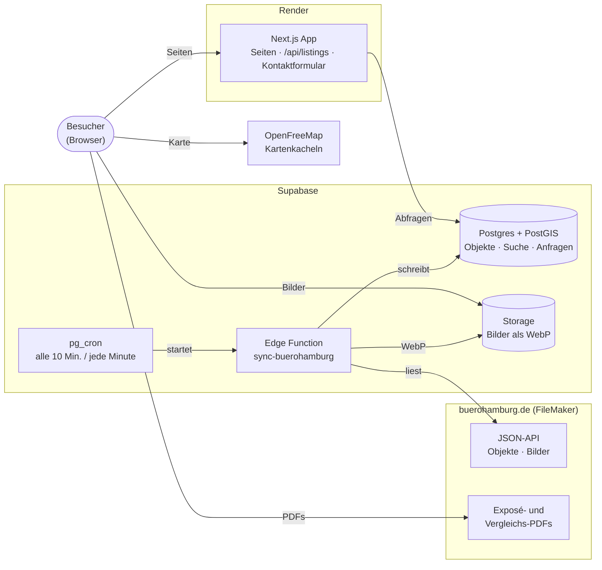

# BüroHamburg.de – Immobiliensuche

MVP einer modernen Gewerbeimmobiliensuche für BüroHamburg.de: Suchfilter oben, Trefferliste links, interaktive Hamburg-Karte rechts, Detailseiten mit Galerie und Kontaktformular.

**Stack:** Next.js 15 (App Router, TypeScript) · Tailwind CSS 4 · shadcn/ui · MapLibre GL JS · Supabase (PostgreSQL + PostGIS)

## Schnellstart

```bash
npm install          # kopiert auch den MapLibre-Worker nach public/vendor/
npm run dev          # http://localhost:3000 → /immobilien
```

Die App benötigt Supabase (siehe [Supabase anbinden](#supabase-anbinden)). Fehlt die Konfiguration oder ist die Datenbank nicht erreichbar, zeigt sie eine **Störungsseite** (`src/app/error.tsx`) – bewusst ohne Rückfall auf Testdaten, damit Interessenten keine veralteten Angebote sehen.

| Script | Zweck |
| --- | --- |
| `npm run dev` / `build` / `start` | Entwicklung / Produktion |
| `npm run lint`, `npm run typecheck` | Qualitätsprüfungen |
| `npm run scrape` | Objektbestand von buerohamburg.de abrufen (`data/scrape/`, siehe unten) |
| `npm run db:seed:generate` | erzeugt `supabase/seed/*.sql` aus dem Scrape |
| `npm run db:seed:linked` | Seed-Pakete ins verknüpfte Supabase-Projekt einspielen |
| `npm run db:push` | neue Migrationen ins verknüpfte Supabase-Projekt einspielen |
| `npm run db:types` | TypeScript-Typen aus dem Datenbankschema generieren |

## Funktionen

- **Suche** nach Stadtteil (Mehrfachauswahl, gruppiert nach Bezirk), Objektart, Lage, Mietfläche und Miete (€/m²)
- **Schnellfilter** (Nutzungsart, provisionsfrei, Neubau, barrierefrei …) und **„Weitere Filter“** mit 20 Ausstattungsmerkmalen
- **Karte** mit Clustering, Farbcodierung nach Objektart, Popup-Karte und Legende
- **Synchronisierung Liste ↔ Karte:** Hover auf einer Karte zeigt den Marker als Preis-Pin (auch innerhalb von Clustern), Klick auf einen Marker öffnet die Objektvorschau und hebt die Karte in der Liste hervor; optional **„Beim Verschieben der Karte suchen“** (PostGIS-Bounding-Box)
- **Alle Suchparameter in der URL** (`/immobilien?stadtteil=hafencity&typ=buero&flaeche_von=200&ausstattung=provisionsfrei`) – teilbar, lesezeichenfähig, „Suche speichern“ kopiert den Link
- **Sortierung** und **Paginierung**, optimistische UI-Updates während der Server neu lädt
- **Detailseite** mit Bildergalerie + Lightbox (Tastatur), Eckdaten, Mietflächen-Tabelle, Objektdaten, Lagekarte, ähnlichen Objekten und **Kontaktformular** (Server Action, Zod-Validierung, Honeypot)
- **Merkliste** ohne Login (lokal im Browser)
- **Responsive:** Desktop als App-Layout in Bildschirmhöhe (Liste scrollt, Karte fix, Größe umschaltbar); mobil Such-Fly-up und Umschalter Liste/Karte

## Architektur



- **Next.js** (auf Render) rendert alle Seiten serverseitig und liest ausschließlich aus Supabase. Ist Supabase nicht erreichbar, erscheint die Störungsseite.
- **Sync:** pg_cron startet die Edge Function. Sie gleicht alle 10 Minuten den Bestand mit der API von buerohamburg.de ab und wandelt jede Minute neue Bilder in WebP um (Details unter [Laufender Abgleich](#laufender-abgleich-mit-buerohamburgde)).
- **Direkt aus dem Browser** kommen Bilder (Supabase Storage), Kartenkacheln (OpenFreeMap) sowie Exposés und Vergleichs-PDFs (buerohamburg.de).
- Der direkte **FileMaker-Sync** über die Data API (`services/filemaker-sync`) ist vorbereitet, aber noch nicht aktiv.

## Projektstruktur

```
src/
  app/
    immobilien/(suche)/     Suchseite (Server Component lädt Treffer anhand der URL)
    immobilien/[objektnr]/  Detailseite (/immobilien/097; alte Titel-Adressen leiten dorthin um)
    merkliste/              Merkliste
    api/listings/           Kurzinfos für die Merkliste
  components/
    search/                 Suchleiste, Filter, Ergebnisliste, Such-Context (URL-State)
    map/                    MapLibre-Karten (Suche + Lage), Stil, Legende
    listing/                Immobilienkarte, Badges, Bilder, Ausstattungs-Icons
    detail/                 Galerie, Kontaktformular, Flächentabelle
    layout/ favorites/ ui/  Header/Footer, Merkliste, shadcn/ui
  lib/
    constants.ts types.ts   Fachliche Stammdaten und Domänenmodell
    search/                 URL-Parameter (parse/serialize)
    data/                   Repository-Interface und Supabase-Implementierung
    actions/                Server Actions (Kontaktanfrage)
supabase/
  migrations/               Schema, View, Suchfunktion, RLS
  seed/                     generiert aus dem Scrape von buerohamburg.de
services/filemaker-sync/    separater Sync-Service FileMaker → Supabase
```

Seiten greifen ausschließlich über `PropertyRepository` (`src/lib/data/repository.ts`) auf Daten zu. Einzige Datenquelle ist Supabase; ohne Konfiguration wirft `getRepository()` einen Fehler, und die Störungsseite erscheint.

## Supabase anbinden

Das Projekt ist mit Supabase Cloud verknüpft (`supabase/config.toml`, CLI als Dev-Abhängigkeit). Für ein neues Projekt bzw. einen neuen Rechner:

1. Einmalig anmelden und verknüpfen (interaktiv, fragt nach dem Datenbank-Passwort):
   ```bash
   npx supabase login
   npx supabase link --project-ref <projekt-ref>
   ```
2. Schema und Testdaten einspielen:
   ```bash
   npx supabase db push --linked --include-seed   # später nur: npm run db:push
   ```
3. `.env.local` anlegen (Vorlage: `.env.example`; Key unter „Project Settings → API Keys“):
   ```
   SUPABASE_URL=https://<projekt>.supabase.co
   SUPABASE_PUBLISHABLE_KEY=<publishable key>
   ```
4. Nach Schemaänderungen: neue Datei unter `supabase/migrations/`, dann `npm run db:push` und `npm run db:types`.

### Daten von buerohamburg.de übernehmen

Bis der FileMaker-Sync läuft, kommt der Objektbestand von der JSON-API, die auch buerohamburg.de selbst nutzt:

```bash
npm run scrape                 # Objekte, Details, Bild-URLs, PDF-Infos → data/scrape/ (CSV + JSON, nicht im Git)
npm run db:seed:generate       # → supabase/seed/*.sql (alle Objekte)
npm run db:seed:linked         # Seed-Pakete einspielen (idempotent, kann wiederholt werden)
```

- Quelle: `/api/objects/search` (Liste), `/api/objects/<nr>` (Details), Bilder `/objects/images/<nr>/NN_webBig.jpg`, Exposé `/objects/pdf/BHI_<nr>.pdf` – Details siehe [buerohamburg.de-API](#buerohamburgde-api)
- Die Feldzuordnung steckt in `supabase/functions/_shared/buerohamburg.ts` (gemeinsam mit dem Sync; Zuordnung FileMaker → App, z. B. `web_suchKrit01–08` → Ausstattungsmerkmale, Courtage-Codes `bc`/`no` = courtagefrei)
- Gleiche Adressen werden zu einem Gebäude zusammengefasst; Schlüssel ist die Objektnummer (`source = 'filemaker'`, `external_id`)
- Danach übernimmt der laufende Abgleich (siehe unten) – der Seed ist nur für die Ersteinrichtung nötig

### Laufender Abgleich mit buerohamburg.de

Die Edge Function `supabase/functions/sync-buerohamburg` hält Supabase aktuell. pg_cron ruft sie auf:

| Zeitplan | Modus | Was passiert |
| --- | --- | --- |
| alle 10 Min. | `sync` | Objektliste abrufen, **Hash je Objekt** mit `properties.source_hash` vergleichen: neue/geänderte Objekte mit Details übernehmen, nicht mehr gelistete archivieren. Zusätzlich werden reihum 60 Objekte vollständig geprüft (Details + Bilder) – alle Objekte etwa alle 3 Stunden. |
| jede Minute | `images` | Bild-Warteschlange: bis zu 8 Bilder je Minute, strikt nacheinander in **WebP 1280 px + 640 px** umwandeln und in Storage (`property-images`) ablegen – ein Bild je Aufruf wegen des CPU-Limits von 2 s. |

- **Löschschutz:** Fehlen mehr als 5 % der Objekte in einem Lauf, wird nichts archiviert. Archivierte Objekte verschwinden sofort von der Seite, kommen zurück, falls sie wieder auftauchen, und werden nach 7 Tagen samt Bildern gelöscht.
- **Bilder** haben inhaltsabhängige Dateinamen (dauerhaft cachebar); bis zur Umwandlung zeigt die Seite das Original von buerohamburg.de.
- **Protokoll:** jede Ausführung landet mit Zahlen in `sync_runs`.
- **Neue Objektarten/Lagen:** Kennt die Zuordnung in `_shared/buerohamburg.ts` eine Objektart nicht, wird das Objekt als Büro übernommen; bei unbekannter Lage wird es nicht übernommen. Beides steht als Warnung in `sync_runs.stats->warnings`. Jedes Objekt wird spätestens alle ~3 Stunden geprüft:
  `select started_at, stats->'warnings' from sync_runs where jsonb_array_length(stats->'warnings') > 0 order by started_at desc;`
- Die Feldzuordnung (`supabase/functions/_shared/buerohamburg.ts`) nutzen Edge Function und Seed gemeinsam.

**Einrichtung** (einmalig, Supabase Pro wegen des Speicherbedarfs von rund 1,6 GB für Bilder):

```bash
npm run db:push                                         # Migration inkl. pg_cron-Zeitplan
npx supabase secrets set SYNC_SECRET=<zufälliger Wert>
npm run functions:deploy
```

Danach im Supabase-Dashboard → SQL Editor:

```sql
select vault.create_secret('https://<projekt>.supabase.co', 'project_url');
select vault.create_secret('<derselbe zufällige Wert>', 'sync_secret');
```

Prüfen: `select * from sync_runs order by started_at desc;` und `select status, count(*) from property_images group by status;`

### Datenmodell

| Tabelle | Inhalt |
| --- | --- |
| `districts` | Stadtteile mit Lage (HH-City, HH-Alster, …) und Mittelpunkt |
| `buildings` | Gebäude: Adresse, Lage, `geography(Point)` mit GiST-Index |
| `properties` | Objekt: Objektnummer, Titel, Texte, Objektart(en), Preisart, Nebenkosten, Courtage, Merkmale, weitere Flächen, Exposé-PDF, Hervorhebung |
| `rental_units` | Mietflächen: Fläche, Miete je m² bzw. Pauschalmiete pro Monat |
| `property_images` | Bilder (Supabase Storage, Bucket `property-images`) |
| `contacts` | Ansprechpartner |
| `inquiries` | Kontaktanfragen aus dem Exposé (anonymes Insert per RLS) |
| `sync_runs` | Protokoll und Watermark des FileMaker-Syncs |

Die View `property_listings` aggregiert Flächen, Preise, Merkmale, Bilder und Kontakt je Objekt; die RPC `search_properties(...)` filtert (inkl. PostGIS-Bounding-Box), Sortierung und Paginierung laufen über PostgREST. RLS gibt nur veröffentlichte Objekte frei; Schreibzugriffe erfolgen ausschließlich über den Service-Role-Key des Sync-Services.

Migration, Seed und Suchfunktion wurden gegen PostgreSQL + PostGIS getestet.

## buerohamburg.de-API

Inoffizielle JSON-API, die die bestehende Website selbst nutzt. Sie ist nicht dokumentiert und kann sich ohne Ankündigung ändern; dahinter liegt das FileMaker-System (Feldnamen `webs_…`). Kein Login, keine Keys. Genutzt von `scripts/scrape-buerohamburg.ts` und der Edge Function `sync-buerohamburg`; URLs und Feldzuordnung zentral in `supabase/functions/_shared/buerohamburg.ts`.

Basis-URL: `https://www.buerohamburg.de` (Stand der Felder: Oktober 2026)

### Endpunkte

Ermittelt aus den JavaScript-Bundles der Website (`/_nuxt/*.js`) und einmal live geprüft. Eine Routenliste veröffentlicht der Server nicht; naheliegende weitere Pfade (`/api/lagen`, `/api/stadtteile`, `/api/objects/all`, `/sitemap.xml` …) liefern alle `404`.

**Objektdaten (lesend, von uns genutzt bzw. nutzbar):**

| Methode | Pfad | Antwort |
| --- | --- | --- |
| GET | `/api/objects/search?lage=…` | `{ total, items: [...] }` – alle passenden Objekte auf einmal, keine Seitenaufteilung, Felder gekürzt (siehe unten) |
| GET | `/api/objects/<objektnr>` | ein Objekt mit allen Feldern, unbekannte Nummer → `404` |
| GET | `/api/objects?nr=<nr>,<nr>,…` | **bis zu 50 Objekte** mit allen Feldern (identisch zum Einzelabruf) als Array, unbekannte Nummern fehlen einfach, mehr als 50 → `400`. Nutzt die Website für Merkliste/Vergleich. |
| GET | `/api/objects/home` | die 4 Top-Objekte der Startseite (alle Felder, Reihenfolge über `webs_home`) |
| GET/HEAD | `/objects/images/<objektnr>/<NN>_webBig.jpg` | Bild groß (JPEG, ~800 KB), `NN` = `01` … `19` |
| GET/HEAD | `/objects/images/<objektnr>/<NN>_web.jpg` | dasselbe Bild klein, 640 × 480 (~140 KB) – von der Website als Vorschau genutzt |
| GET/HEAD | `/objects/pdf/BHI_<objektnr>.pdf` | Exposé-PDF |
| – | `/objekt.php?objekt=<objektnr>` | Detailseite der alten Website (HTML) |

**Weitere Endpunkte der Website** (von uns nicht genutzt):

| Methode | Pfad | Zweck |
| --- | --- | --- |
| GET | `/api/gesuche` | aktuelle Mietgesuche für die Seite „Für Vermieter“ (`webs_objekttitel`, `webs_lage`, `webs_beschreibung`, `webs_mietflaeche…`, `webs_ansprechpartner`, `webs_lieferung`) |
| GET | `/api/pdf/merkliste?nr=<nr>,…` | PDF-Liste mehrerer Objekte (bei mehr als 50 Objekten ohne `nr`, dann aus der Sitzung) |
| GET | `/api/pdf/vergleich?nr=<nr>,…` | Vergleichs-PDF (höchstens 50 Objekte) |
| GET / POST / DELETE | `/api/merkliste` | Merkliste der Sitzung (Cookie): lesen → `{ id, objektnr: [] }`, `POST { objektnr }`, `DELETE ?objektnr=` |
| POST | `/api/merkliste/teilen` | Merkliste speichern → `{ id }` zum Teilen |
| POST | `/api/merkliste/laden` | geteilte Merkliste laden, `{ merkliste: <id> }` |
| POST | `/api/suchauftrag` | Suchauftrag absenden (`name`, `email`, `telefon`, `objektart`, `lage`, `mietflaeche_von/bis`, `mietpreis_von/bis`, `kriterien`, `kommentar`, `website` = Spam-Falle) – löst echte E-Mails aus, **nicht testen** |
| GET | `/api/dsgvo?uid=…` | Bestätigung der Datenschutz-Einwilligung aus E-Mail-Links → `{ ok, status }` |

Die Merkliste-Aufrufe senden den Header `X-Consent-Functionality: 1`, wenn der Besucher funktionalen Cookies zugestimmt hat.

**Suche – Parameter** (mehrfach angeben = ODER-Verknüpfung):

- `lage` (Pflicht): `HH-City`, `HH-City-Süd`, `HH-Alster`, `HH-West`, `HH-Nord`, `HH-Ost`, `HH-Süd`. Ohne `lage` liefert die API keine Treffer.
- `objektart` (optional): `Büro`, `Laden`. Unbekannte Werte (z. B. `Halle`) → `400`. Gemischte Objekte mit Halle/Lager-Anteil kommen über `Büro` mit; **reine** Hallen/Lager- und Gastro-Objekte nur ohne `objektart`.
- `flaeche_von`, `flaeche_bis` (optional): Fläche in m², filtert serverseitig. Alle übrigen Filter der Website (Stadtteil, Mietpreis, Merkmale) laufen nur im Browser; solche Parameter ignoriert die API.
- Scraper und Sync fragen alle sieben Lagen **ohne** `objektart` ab = Gesamtbestand (1.172 Objekte, Stand 25.10.2026; mit `objektart=Büro&objektart=Laden` wären es nur 1.165).

### curl-Beispiele

Umlaute in URLs kodiert (`ü` = `%C3%BC`). `-s` unterdrückt die Fortschrittsanzeige, `| jq` (optional) formatiert JSON.

**Objektdaten**

```bash
# Gesamtbestand (alle sieben Lagen)
curl -s 'https://www.buerohamburg.de/api/objects/search?lage=HH-Nord&lage=HH-Alster&lage=HH-West&lage=HH-City&lage=HH-City-S%C3%BCd&lage=HH-Ost&lage=HH-S%C3%BCd' | jq '.total'

# nur Büros in der City mit 500–1.000 m²
curl -s 'https://www.buerohamburg.de/api/objects/search?lage=HH-City&objektart=B%C3%BCro&flaeche_von=500&flaeche_bis=1000' | jq '.total'

# ein Objekt mit allen Feldern
curl -s 'https://www.buerohamburg.de/api/objects/946' | jq

# mehrere Objekte mit allen Feldern (höchstens 50 Nummern)
curl -s 'https://www.buerohamburg.de/api/objects?nr=946,2352,25703' | jq 'map({webs_objektnr, webs_objekttitel})'

# Top-Objekte der Startseite
curl -s 'https://www.buerohamburg.de/api/objects/home' | jq 'map({webs_objektnr, webs_home})'
```

**Bilder und PDFs**

```bash
# prüfen, ob Bild 01 existiert (200 = ja, 404 = nein)
curl -sI 'https://www.buerohamburg.de/objects/images/946/01_webBig.jpg'

# Bild groß bzw. klein (640 × 480) herunterladen
curl -s -o 946_01.jpg       'https://www.buerohamburg.de/objects/images/946/01_webBig.jpg'
curl -s -o 946_01_klein.jpg 'https://www.buerohamburg.de/objects/images/946/01_web.jpg'

# Exposé herunterladen
curl -s -o BHI_946.pdf 'https://www.buerohamburg.de/objects/pdf/BHI_946.pdf'

# PDF-Liste bzw. Vergleichs-PDF mehrerer Objekte (nur GET, HEAD liefert 404)
curl -s -o merkliste.pdf 'https://www.buerohamburg.de/api/pdf/merkliste?nr=946,2352'
curl -s -o vergleich.pdf 'https://www.buerohamburg.de/api/pdf/vergleich?nr=946,2352'
```

**Weitere Endpunkte**

```bash
# Mietgesuche (Seite „Für Vermieter“)
curl -s 'https://www.buerohamburg.de/api/gesuche' | jq 'map({webs_objekttitel, webs_lage, webs_mietflaeche})'

# Datenschutz-Bestätigung (uid stammt aus dem E-Mail-Link)
curl -s 'https://www.buerohamburg.de/api/dsgvo?uid=<uid>'
```

**Merkliste** – an die Sitzung gebunden. Das Cookie wird in `cookies.txt` gespeichert und wieder mitgeschickt (`-c` / `-b`):

```bash
# lesen (legt beim ersten Aufruf eine Sitzung an)
curl -s -c cookies.txt -b cookies.txt 'https://www.buerohamburg.de/api/merkliste'

# Objekt hinzufügen / entfernen
curl -s -c cookies.txt -b cookies.txt -X POST 'https://www.buerohamburg.de/api/merkliste' \
  -H 'Content-Type: application/json' -H 'X-Consent-Functionality: 1' -d '{"objektnr":"946"}'
curl -s -c cookies.txt -b cookies.txt -X DELETE 'https://www.buerohamburg.de/api/merkliste?objektnr=946' \
  -H 'X-Consent-Functionality: 1'

# teilen → { "id": "…" } · geteilte Merkliste in eine Sitzung laden
curl -s -c cookies.txt -b cookies.txt -X POST 'https://www.buerohamburg.de/api/merkliste/teilen' -H 'X-Consent-Functionality: 1'
curl -s -c cookies.txt -b cookies.txt -X POST 'https://www.buerohamburg.de/api/merkliste/laden' \
  -H 'Content-Type: application/json' -H 'X-Consent-Functionality: 1' -d '{"merkliste":"<id>"}'
```

**Suchauftrag** – ⚠️ verschickt echte E-Mails an BüroHamburg, nur nach Absprache ausführen. `website` muss leer bleiben (Spam-Falle). Das Format von `objektart`, `lage` und `kriterien` ist aus dem Website-Code abgeleitet und nicht live geprüft:

```bash
curl -s -X POST 'https://www.buerohamburg.de/api/suchauftrag' \
  -H 'Content-Type: application/json' \
  -d '{
    "name": "Max Mustermann",
    "email": "max@example.com",
    "telefon": "040 123456",
    "objektart": ["Büro"],
    "lage": ["HH-City", "HH-Alster"],
    "mietflaeche_von": "200",
    "mietflaeche_bis": "400",
    "mietpreis_von": "15",
    "mietpreis_bis": "25",
    "kriterien": ["Balkon / Terrasse"],
    "kommentar": "Test – bitte ignorieren",
    "website": ""
  }'
```

### Felder

Die Liste liefert eine Teilmenge der Felder, die Details liefern alle. Werte kommen teils als Zahl, teils als Text mit deutschem Zahlenformat.

| Feld | Liste | Bedeutung | Beispiel | → App |
| --- | :---: | --- | --- | --- |
| `webs_objektnr` | ✓ | Objektnummer, eindeutiger Schlüssel | `"946"` | `external_id`, URL-Slug |
| `webs_objekttitel` | ✓ | Titel | | `title` |
| `webs_objektart` | – | Objektart(en), bei gemischten Objekten zeilenweise: `Büro/Praxis`, `Laden`, `Gastro`, `Halle/Lager/Prod.` | `"Büro/Praxis"` | `categories` |
| `webs_lage` | ✓ | Marktgebiet (siehe `lage`) | `"HH-Nord"` | `market_area` |
| `webs_stadtteil` | ✓ | Stadtteil | `"Groß Borstel"` | `district` |
| `webs_strasse` | ✓ | Straße | `"Papenreye"` | |
| `webs_hausnummer` | – | Hausnummer, auch Bereiche | `"51-65"` | Gebäudeschlüssel (Straße + Nr. + PLZ) |
| `webs_plz`, `webs_ort` | ✓ | PLZ, Ort | `"22453"`, `"Hamburg"` | |
| `webs_lat`, `webs_lng` | ✓ | Koordinaten als Text, leer/`0` = unbekannt | `"53.6137723"` | `location` |
| `webs_mietflaeche` | ✓ | Fläche in m² (Zahl) | `15` | `area` |
| `webs_mietflaeche_von` / `_bis` | ✓ | teilbare Fläche als Text | `"ab ca. 15 qm"` | `area_range_min/max` |
| `webs_mietFormel` | ✓ | Miete je m² (Zahl) | `23.33` | `rent_per_sqm` |
| `webs_miete` | ✓ | Miete als Text; je nach `webs_preisart` pro m² oder pro Monat | `"350"` | `rent_total_monthly` (bei `Monat`) |
| `webs_preisart` | ✓ | `qm` oder `Monat` | `"Monat"` | `price_type` |
| `webs_mwst` | ✓ | Nebenkosten-/MwSt.-Hinweis | `"inkl. NK, zzgl. MwSt."` | `price_note` |
| `webs_court_text` | ✓ | Courtage-Code: `bc` = courtagefrei, `no` = courtagefrei bei fester Laufzeit, Zahl = Monatsmieten | `"bc"` | `commission_free`, Merkmal „Provisionsfrei“ |
| `webs_court` | ✓ | Courtage als Satz | | `commission_note` |
| `webs_beschreibung` | ✓ | Beschreibung – in der Liste auf 300 Zeichen gekürzt (`…`), vollständig nur in den Details | | `description` |
| `webs_home` | – | Rang für „Top-Objekte“ auf der Startseite, leer = keins | `""` | `featured_rank` |
| `webs_suchbegriffe` | – | interne Suchkennungen, Bedeutung unklar, ungenutzt | `"   1   1 "` | – |
| `web_suchKrit01` … `08` | teils | Merkmale, `1` = ja, `""` = nein (siehe unten). `03` und `06` fehlen in der Liste | `1` | `features` |
| `recordId` | – | interne FileMaker-Datensatz-ID; ändert sich, darum vom Hash ausgenommen | `"3440117053"` | – |

Merkmale (`web_suchKrit…`):

| Feld | Merkmal | Feld | Merkmal |
| --- | --- | --- | --- |
| `01` | Balkon / Terrasse | `05` | Erdgeschossfläche |
| `02` | Barrierefrei | `06` | Neubau |
| `03` | Personenaufzug | `07` | Hauseigene Parkplätze |
| `04` | Lastenaufzug | `08` | Wasserblick |

### Bilder und Exposé

- Bilder sind nummeriert (`01_webBig.jpg`, `02_webBig.jpg`, …, höchstens 19), aber **nicht immer lückenlos** – bei 25702 fehlt z. B. die `01`. Eine Bildliste gibt es nicht; die Website prüft alle 19 Nummern. Scraper und Sync prüfen per `HEAD` und hören erst nach 3 fehlenden Nummern in Folge auf.
- Das Exposé gibt es nicht zu jedem Objekt. Ob es existiert, erkennt man am `Content-Type: application/pdf` (Antwort per `HEAD`).

### Besonderheiten

- **Sporadische 404:** Unter Last antwortet die API gelegentlich mit `404`, obwohl das Objekt existiert. Scraper und Sync wiederholen deshalb auch `404`/`429` bis zu fünfmal mit wachsender Pause; einzelne Abrufe können trotzdem scheitern (`sync_runs.failed`) und klappen beim nächsten Lauf.
- **Schonend abfragen:** höchstens 2–3 parallele Anfragen. Der Sync lädt Details nur für neue/geänderte Objekte (Hash über den Listeneintrag) und prüft reihum 60 Objekte je Lauf vollständig.
- **Gleiche Adresse, mehrere Angebote:** Jede Fläche ist ein eigenes Objekt; wir fassen sie über Straße, Hausnummer und PLZ zu einem Gebäude zusammen.

## FileMaker-Integration (vorbereitet)

`services/filemaker-sync` ist ein eigenständiges Node-Paket, das über die **FileMaker Data API** liest und per Upsert nach Supabase schreibt:

- Delta-Sync anhand des Änderungszeitstempels (Watermark in `sync_runs`), `--full` für Vollabgleich
- idempotente Upserts über `(source, external_id)` in allen synchronisierten Tabellen
- Bilder aus Container-Feldern → Supabase Storage (Prüfsumme verhindert Doppel-Uploads)
- Export neuer Kontaktanfragen zurück nach FileMaker
- fehlerhafte Einzeldatensätze werden protokolliert, ohne den Lauf abzubrechen

```bash
cd services/filemaker-sync
npm install
cp .env.example .env    # FileMaker- und Supabase-Zugangsdaten eintragen
npm run sync            # einmalig; SYNC_INTERVAL_MINUTES für Daemon-Betrieb
```

> Layout- und Feldnamen (`src/config.ts`, `src/filemaker/types.ts`, `src/mapping.ts`) sind Annahmen und müssen mit der realen FileMaker-Lösung abgeglichen werden.

## Vor dem Go-live

Offene Punkte, die vor der Umstellung von www.buerohamburg.de geklärt bzw. umgesetzt sein müssen:

- [ ] **Objektanfragen landen nur in der Datenbank.** Das Formular auf den Objektseiten (`src/lib/actions/inquiry.ts`) speichert Anfragen in der Tabelle `inquiries` – es wird **niemand benachrichtigt**. Auf der bisherigen Website gab es kein solches Formular (nur E-Mail und Telefon). Vor dem Go-live entscheiden: Benachrichtigung einbauen (E-Mail an BüroHamburg, Datenbank-Webhook oder Export nach FileMaker, siehe `services/filemaker-sync`) – oder das Formular durch E-Mail/Telefon ersetzen. Sonst gehen Kundenanfragen unbemerkt verloren.
- [ ] **Datenschutzerklärung freigeben** (`src/content/legal/datenschutz.ts`, Entwurf an die neue Website angepasst): Freigabe durch BüroHamburg bzw. Datenschutzbeauftragten; Anschriften von Render, Supabase und SalesViewer prüfen; Serverstandorte (Region von Render und Supabase) ergänzen; bestätigen, dass Suchaufträge per E-Mail ans Team gehen.
- [ ] **Auftragsverarbeitungsverträge** mit Render, Supabase und – falls weiter genutzt – SalesViewer abschließen.
- [ ] **SalesViewer klären:** Wird es weiter genutzt? Falls nein, `NEXT_PUBLIC_SALESVIEWER_ID=""` setzen und Abschnitt 6.1 der Datenschutzerklärung sowie die Kategorie „Externe Dienste & Marketing“ im Cookie-Hinweis entfernen. Bei einer anderen Domain als buerohamburg.de ggf. im SalesViewer-Konto eintragen.
- [ ] **Adresse im Vergleichs-PDF bestätigen:** Das alte PDF nennt „Poststraße 37“, die Website „Hohe Bleichen 21“ (verwendet wird `COMPANY` in `src/lib/company.ts`).
- [ ] **Suchauftrag:** wird nur im Produktivbetrieb an `/api/suchauftrag` weitergeleitet (lokal nur protokolliert, da die API echte E-Mails verschickt). Nach dem Go-live einmal mit einem gekennzeichneten Testauftrag prüfen und mit BüroHamburg abstimmen. Es gibt außer dem Honeypot keine Begrenzung der Anfragen pro Zeit.
- [ ] **Cookie-Hinweis:** nutzt dasselbe Cookie `cc_cookie` (Revision 1) wie die bisherige Website, damit bestehende Einwilligungen auf derselben Domain gültig bleiben. Bei geänderten Kategorien/Diensten `CONSENT_REVISION` in `src/lib/consent.ts` erhöhen.

## Hinweise

- **Karte:** Standardstil ist OpenFreeMap „Positron“ (kostenlos, ohne API-Key). Für den Produktivbetrieb ggf. eigenen Stil/Anbieter über `NEXT_PUBLIC_MAP_STYLE_URL` setzen.
- **Bilder & PDFs:** werden aktuell von buerohamburg.de geladen; später über den Sync in Supabase Storage.
- **Ansprechpartner:** Objekte ohne zugeordneten Kontakt zeigen den allgemeinen BüroHamburg-Kontakt.
- **Inhaltsseiten:** Home, Über uns und Für Vermieter sind eigene Seiten; Suchauftrag, Impressum, Datenschutz, AGB und Cookie-Einstellungen öffnen als Fenster. Mietgesuche und Suchauftrag laufen weiterhin über die API von buerohamburg.de.
- Bewusst nicht enthalten: Registrierung/Login und ein eigenes Verwaltungsbackend.
